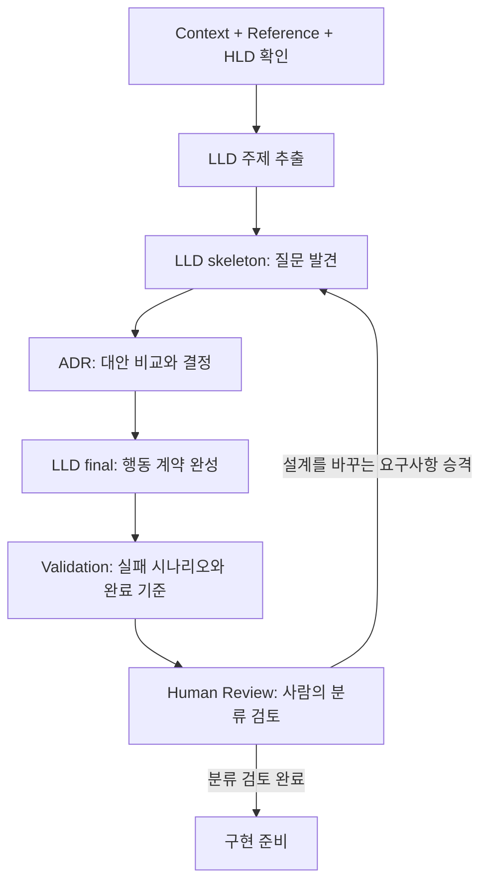

# Plan Harness

AI 에이전트와 소프트웨어를 설계할 때 **무엇을 읽고, 어떤 순서로 결정하고, 무엇으로 완료를 판단할지** 정하는 문서 하네스다. 질문은 LLD skeleton, 결정과 근거는 ADR, 상세 동작은 final LLD, 검증 기준과 허용한 한계는 Validation에 남긴다.

Codex와 Hermes는 루트 [AGENTS.md](./AGENTS.md)에서 시작하고, Claude Code는 루트 [CLAUDE.md](./CLAUDE.md)를 통해 같은 안내를 읽는다. 설계 절차의 원본은 [docs/CLAUDE.md](./docs/CLAUDE.md) 한 곳에서 관리한다.

## 설계가 진행되는 흐름



- HLD는 시스템 경계와 큰 흐름을, LLD는 구체적인 행동 계약을 정의한다. HLD와 LLD는 언어·프레임워크에 독립적으로 작성한다.
- 확정된 외부 시스템과 기술 환경은 Reference에 둔다. 아직 결정하지 않은 선택은 ADR에서 다룬다.
- 입력에 모순이 있으면 먼저 보고하고 멈춘다. 충분한 입력이 있으면 단계별 산출물을 차례로 작성하고 Validation 뒤의 Human Review에서 멈춘다.
- AI는 Validation의 초기 분류를 제안한다. 기존 항목의 카테고리 변경과 위험 수락은 사람이 판단한다.

설계 검토가 끝나도 구현과 테스트가 자동으로 완료되는 것은 아니다. `MUST_PASS`는 실제 확인 근거가 있어야 통과이며, 구현·빌드·테스트 규칙은 적용할 서비스 저장소에서 정한다.

## 에이전트와 시작하기

```sh
git clone https://github.com/brightJoo/planharnessdocs.git
cd planharnessdocs
```

이 폴더를 Codex 프로젝트로 열거나 터미널에서 `codex`를 실행한다. Hermes는 모델과 파일 읽기 도구가 설정된 환경에서 다음처럼 시작한다.

```sh
hermes --in .
```

새 세션에서 먼저 아래처럼 요청한다.

```text
AGENTS.md와 docs/CLAUDE.md를 읽고, 실제로 읽은 파일 경로를 알려줘.
docs/context/traffic-recording-replay.md와 관련 Reference를 확인해줘.
설계를 시작하는 데 필요한 HLD와 입력 중 무엇이 있고 무엇이 빠졌는지 정리해줘.
지금은 문서나 코드를 생성하지 말고 입력 점검 결과만 보고해줘.
```

현재 저장소에는 HLD가 없으므로 첫 단계는 입력 점검이다. HLD를 준비한 뒤 사용할 설계 요청과 다른 서비스에 연결하는 방법은 [적용 가이드](./docs/README.md)에 있다.

### 에이전트별 연결

| 에이전트 | 프로젝트 진입점 | 확인할 점 |
| --- | --- | --- |
| Codex | [AGENTS.md](./AGENTS.md) → `docs/CLAUDE.md` 읽기 지시 | 프로젝트 루트에서 새 세션을 시작한다. |
| Hermes | [AGENTS.md](./AGENTS.md) → `docs/CLAUDE.md` 읽기 지시 | `--in`으로 작업 폴더를 지정한다. `.hermes.md` 등 별도 진입점이 있으면 같은 연결을 추가한다. |
| Claude Code | [CLAUDE.md](./CLAUDE.md) → `AGENTS.md` 가져오기 | 설계 절차는 공통 원본을 읽으며, 별도 사본으로 유지하지 않는다. |

Markdown 링크 자체가 다른 파일의 내용을 자동으로 읽게 하지는 않는다. 시작 요청에서 읽은 파일을 확인한다. 에이전트별 발견 방식은 [Codex 공식 문서](https://developers.openai.com/codex/guides/agents-md), [Hermes 공식 문서](https://hermes-agent.nousresearch.com/docs/user-guide/features/context-files), [Claude Code 공식 문서](https://code.claude.com/docs/en/memory)를 참고한다.

## 현재 포함된 자료

```text
planharnessdocs/
├── README.md                     # 목적과 시작 방법
├── AGENTS.md                     # Codex·Hermes 공통 진입점
├── CLAUDE.md                     # Claude Code 진입점
└── docs/
    ├── README.md                 # 서비스 적용 방법과 작업 요청
    ├── CLAUDE.md                 # 공통 설계 절차와 산출물 규칙
    ├── example.md                # 한 번의 iteration 설명
    ├── context/
    │   └── traffic-recording-replay.md
    └── reference/
        ├── cache/caching.md
        ├── kafka/produce.md
        ├── kafka/consume.md
        ├── object-storage/s3.md
        └── replay/mock-users.md
```

`docs/hld/`, `docs/lld/skeleton/`, `docs/lld/final/`, `docs/adr/`, `docs/validation/`은 실제 설계 작업에서 만들 산출물 경로다. 현재 저장소에는 해당 파일이 없으며, [example.md](./docs/example.md)는 흐름을 설명하는 예시다.

포함된 Context와 Reference는 운영 트래픽 레코딩·리플레이 사례의 자료다. 다른 서비스에서 사용할 때는 해당 서비스의 사실과 제약으로 바꾸어 확인한다.

## 서비스 저장소에 가져오기

이 저장소의 **`docs/` 내용**을 서비스의 `docs/`로 가져오고, 서비스 루트의 `AGENTS.md` 또는 `CLAUDE.md`에 공통 규칙을 읽도록 연결한다. 기존 서비스 지침은 보존한다.

저장소 전체를 서비스의 `docs/`에 submodule로 넣으면 `docs/docs/CLAUDE.md`가 되므로 현재 규칙의 경로와 맞지 않는다. 복사 절차와 기존 `docs/`가 있을 때의 병합 방법은 [적용 가이드](./docs/README.md)를 따른다.

## 다음으로 읽을 문서

- [적용 가이드](./docs/README.md): 준비할 입력, 서비스에 가져오는 방법, 에이전트 요청 예시.
- [설계 규칙](./docs/CLAUDE.md): 단계 0~8, 파일 형식, Validation과 반복 종료 조건.
- [설계 예시](./docs/example.md): 질문이 결정·상세 설계·검증 항목으로 이어지는 과정.
